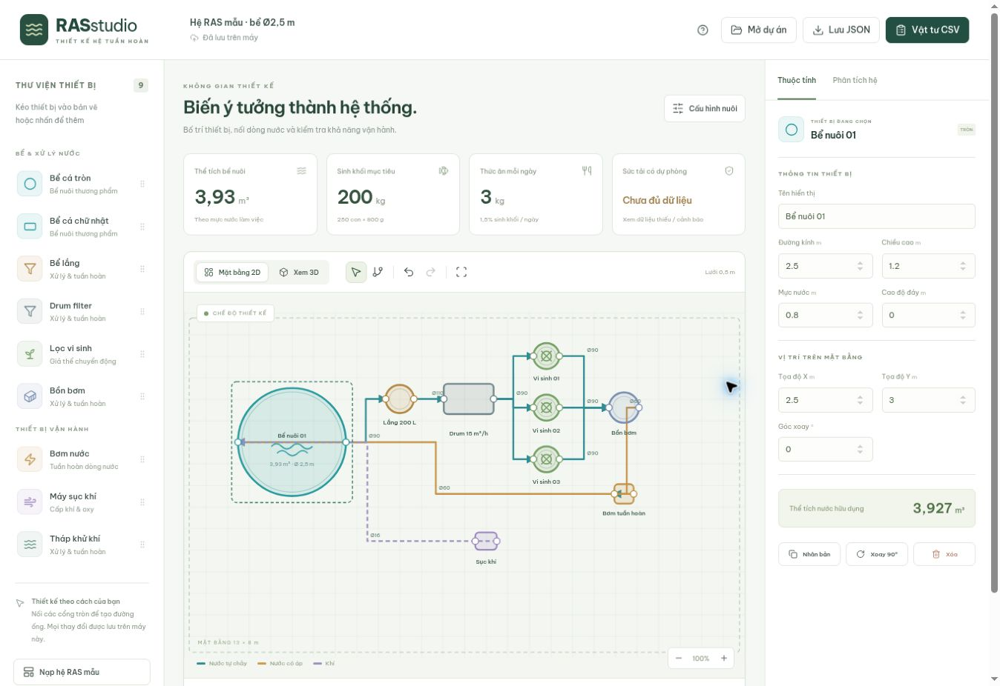

# RAS Studio

**Demo:** https://nckh-longt.github.io/design-3d-RAS-system/

Ứng dụng web tiếng Việt để bố trí hệ nuôi cá tuần hoàn (RAS), chỉnh thiết bị/đường ống và sàng lọc các giới hạn vận hành. Mặt bằng 2D, hai chế độ xem 3D và bộ tính dùng chung một dự án JSON.



## Chức năng đã có

- Kéo thiết bị vào mặt bằng hoặc nhấn để thêm; di chuyển trên lưới 5 cm, xoay, nhân bản, xóa.
- 9 loại: bể tròn, bể chữ nhật, bể lắng, drum filter, lọc vi sinh, bồn bơm, bơm nước, máy sục khí và tháp khử khí.
- Chỉnh kích thước, cao độ đáy, mực nước, vị trí và thông số thiết bị.
- Nối hai cổng để tạo tuyến có hướng; chỉnh đường kính **trong**, loại tuyến, chiều dài bổ sung, hệ số K phụ kiện và trạng thái van.
- Kéo điểm gấp trên tuyến đang chọn; chiều dài cập nhật khi di chuyển thiết bị.
- Phân biệt nước tự chảy, nước có áp, đường khí và xả cặn; kết nối nhiều nhánh tại cùng cổng.
- 3D WebGL bằng Three.js; tự chuyển sang hình chiếu 3D SVG có thể xoay khi WebGL không khả dụng.
- Tính thể tích nước, sinh khối, thức ăn, tải TAN-N, giới hạn vi sinh/oxy/mật độ với dự phòng, điện năng và chi phí điện.
- Ước tính điểm làm việc một tuyến đẩy nối tiếp theo đường bơm parabol và Darcy–Weisbach.
- Chỉ tính năng lực vi sinh trong vòng tuần hoàn kín của bể nuôi. Đóng van có thể loại thiết bị khỏi bộ tính.
- Tự lưu trên trình duyệt; mở/xuất JSON có kiểm tra dữ liệu; xuất danh mục thiết bị và từng tuyến ống CSV UTF-8; hoàn tác/làm lại.
- Giao diện responsive, hướng dẫn, phương pháp và cảnh báo dữ liệu thiếu ngay trong ứng dụng.

## Chạy trên máy

Yêu cầu Node.js 22 trở lên và npm.

```bash
npm ci
npm run dev
```

```bash
npm test
npm run build
npm run preview
```

Build tĩnh nằm trong `dist/`. Không cần backend, database hoặc API key. Font Be Vietnam Pro tải từ Google Fonts; có font hệ thống dự phòng.

## Triển khai GitHub Pages

Workflow `.github/workflows/pages.yml` kiểm thử, build và deploy từ nhánh `main`. Trong Settings → Pages, chọn Source là **GitHub Actions**. Workflow đặt `GITHUB_PAGES=true` để build đúng base `/design-3d-RAS-system/`; các nền tảng khác vẫn dùng `/`.

```bash
GITHUB_PAGES=true npm run build
```

Đã deploy và xác minh giao diện 2D/3D tại [demo GitHub Pages](https://nckh-longt.github.io/design-3d-RAS-system/). Push lên `main` sẽ tự cập nhật demo sau khi workflow thành công.

## Triển khai Vercel

Repository đã có `vercel.json`:

- Framework: Vite.
- Install: `npm ci` (tự nhận từ lockfile).
- Build: `npm run build`.
- Output: `dist`.
- Root: thư mục gốc repository.
- Không cần biến môi trường.

Import repository `NCKH-LongT/design-3d-RAS-system` trong tài khoản/team Vercel mong muốn, chọn nhánh `main` và Deploy. Có thể chạy `vercel --prod` trong checkout đã được xác thực. Không đưa token Vercel vào source hoặc `vercel.json`.

**Trạng thái:** demo hiện chạy trên GitHub Pages; chưa triển khai Vercel. Xem [checklist.md](checklist.md).

## Hướng dẫn nhanh

1. Bắt đầu từ hệ mẫu hoặc Dự án trống.
2. Kéo bể và cụm lọc vào mặt bằng; nhập kích thước thật và mực nước làm việc.
3. Nhấn cổng ra rồi cổng vào để nối tuyến. Nhấn ống để chỉnh đường kính trong, loại và van.
4. Nhập lượng giá thể theo lít, bề mặt được bảo vệ và tốc độ xử lý TAN đã xác minh.
5. Nhập khí tại áp suất làm việc và hiệu suất truyền oxy thực ở thiết bị sục. Giá trị 0 biểu thị chưa có dữ liệu.
6. Trong Cấu hình nuôi, nhập số cá, trọng lượng mục tiêu, tỷ lệ ăn và lưu lượng nước đo/xác minh.
7. Xem Phân tích hệ để kiểm tra các giới hạn và dữ liệu còn thiếu. Lưu JSON để chuyển máy hoặc sao lưu.

Phím tắt: `V` chọn, `P` nối ống, `Esc` hủy nối, `Delete` xóa; `Ctrl/Cmd+Z` hoàn tác, `Ctrl/Cmd+Shift+Z` làm lại. Cuộn để zoom 2D; Shift+cuộn dịch ngang, Alt+cuộn dịch dọc. Trong 3D kéo để xoay.

## Phương pháp tính

| Đại lượng | Công thức / điều kiện |
| --- | --- |
| Bể tròn | V = πD²h / 4; h là chiều sâu nước |
| Bể chữ nhật | V = rộng × dài × h |
| Sinh khối | N × trọng lượng thu hoạch kg/con |
| Thức ăn | Sinh khối × tỷ lệ ăn (%)/100, kg/ngày |
| TAN-N | Thức ăn × hệ số g TAN-N/kg thức ăn |
| Năng lực vi sinh | m³ giá thể × m² bề mặt bảo vệ/m³ × g TAN-N/m²/ngày |
| Oxy cá | Sinh khối × mg O₂/kg/h / 10⁶ |
| Oxy nitrat hóa | kg TAN-N/ngày × 4,57 / 24 |
| Oxy hữu cơ | Thức ăn × hệ số kg O₂/100 kg thức ăn / 100 / 24 |
| Oxy cấp | L khí/phút × 60/1000 × 0,279 kg O₂/m³ không khí × hiệu suất thực/100 |
| Sức tải sàng lọc | Min(giới hạn mật độ, TAN, oxy) × (1 − dự phòng/100) / kg mỗi con |
| Tổn thất có áp | (fL/D + ΣK) × v²/(2g) |
| Đường bơm xấp xỉ | H = Hmax × [1 − (Q/Qmax)²] |

Nhiệt độ, pH, độ mặn và % đạm hiện được ghi nhận, **chưa tự hiệu chỉnh** các hệ số. Hệ số mẫu không phải khuyến cáo riêng cho một loài cá. Lưu lượng bằng 0, thiếu dữ liệu oxy/vi sinh, thiếu vòng kín hoặc lưu lượng xác minh dưới mục tiêu tuần hoàn sẽ chặn hiển thị số cá.

Tính ống dùng độ nhám PVC 0,0015 mm, độ nhớt động học 10⁻⁶ m²/s; f = 64/Re khi Re < 2300, Swamee–Jain ở giá trị lớn hơn. Vùng chuyển tiếp chỉ được xấp xỉ. Chiều dài tuyến = chiều dài mặt bằng trực giao + chênh cao tâm nước hai thiết bị + phần bổ sung. Cột áp tĩnh do người dùng khai báo theo chênh cao mặt nước nguồn và nhận. K là đầu vào thủ công, chưa tự đếm co/T/van.

## Giới hạn cần biết

- Đây là công cụ sàng lọc thiết kế, **chưa phải chứng nhận sức tải hoặc bản vẽ thi công**.
- Chưa giải mạng tự chảy đầy/không đầy ống, phân phối lưu lượng song song, cao độ mực nước, đường hút/NPSH, nhiều bơm hay tổn thất của từng thiết bị lọc.
- Sức tải hiển thị là giới hạn theo ba mô hình gộp, chưa xét riêng từng bể, phân phối khí, đỉnh tiêu thụ oxy, khả năng đảo giá thể, CO₂, NO₂/NO₃ hoặc tăng trưởng cá theo thời gian.
- Máy khí phải có đường khí đang mở trực tiếp tới bể nuôi để được tính. Chưa hỗ trợ riêng các đầu sục trong lọc vi sinh hoặc oxygen cone.
- Công suất drum chỉ đối chiếu sơ bộ với tổng lưu lượng khai báo; tháp khử khí hiện là thiết bị bố trí, chưa tính năng lực loại CO₂.
- Chưa có mô phỏng tắc lọc, nước hồi/cạn bồn khi mất điện, hút ngược, dự phòng oxy hoặc xác định thời gian an toàn khi ngừng thiết bị.
- Van được biểu diễn bằng trạng thái của tuyến; co/T/thu cỡ chưa là đối tượng CAD riêng. Hệ số tổn thất và chiều dài bổ sung nhập trong thuộc tính ống.
- Dữ liệu lưu trên trình duyệt, không đồng bộ tài khoản. 3D chỉ phản ánh bố trí và kích thước, không phải CFD.

## Cấu trúc mã

```text
src/model.js             Schema, thiết bị mẫu, cổng, tuyến, kiểm tra JSON
src/calc.js              Thể tích, TAN, oxy, sức tải, đường bơm và tổn thất
src/app.js               Trình thiết kế SVG, bảng thông số, lưu/mở và xuất CSV
src/view3d.js            Hiển thị WebGL, chọn thiết bị, camera
src/view3d-fallback.js   Hình chiếu 3D SVG khi không có WebGL
src/style.css           Giao diện và responsive
tests/calc.test.js      Kiểm thử tính toán và dữ liệu
vercel.json             Cấu hình triển khai tĩnh
```

## Kiểm thử

`npm test` kiểm tra thể tích bể tròn, chiều biến thiên tổn thất, tải TAN, thiếu oxy, thiếu lưu lượng, ngắt vòng tuần hoàn, loại lọc rời khỏi sức tải, giao điểm đường bơm, chặn tuyến đẩy phân nhánh và kiểm tra JSON nhập. GitHub Actions chạy test và build khi push hoặc mở PR.

Kiểm thử giao diện thực hiện qua trình duyệt: sửa kích thước và tính lại thể tích, kéo bể, thêm lọc, tạo ống bằng cổng, đổi đường kính, đóng van, phân tích hệ hoàn tác, nhập/xuất JSON và CSV. WebGL không khả dụng trên trình duyệt kiểm thử; chế độ 3D SVG được kiểm tra thay thế. WebGL chính đã qua build, chưa được kiểm chứng trực quan trong môi trường có GPU.

## Tham khảo

- [US EPA — EPANET](https://www.epa.gov/water-research/epanet)
- [FAO — Recirculating systems and re-use of water in aquaculture](https://www.fao.org/4/x5744e/x5744e0g.htm)

Theo dõi công việc và phạm vi mở rộng trong [checklist.md](checklist.md).
