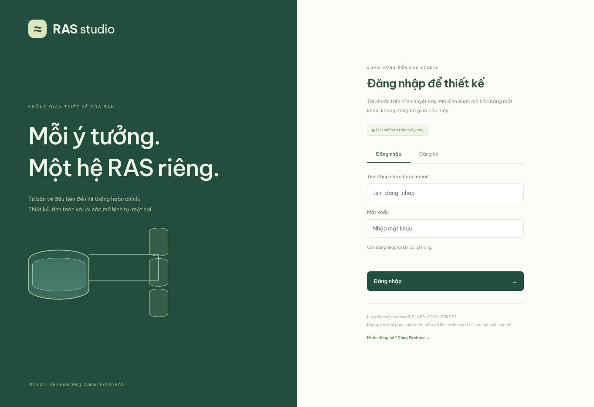

# Liêm RAS Studio 1.2

**Demo:** https://nckh-longt.github.io/design-3d-RAS-system/



Web tiếng Việt để thiết kế hệ RAS bằng kéo thả 2D, kiểm tra 3D, tính tải nuôi và mô phỏng các kịch bản vận hành. Đăng nhập trước khi mở editor; mỗi tài khoản quản lý nhiều mô hình.

## Bắt đầu

1. Mở demo, chọn **Đăng ký** ở lần dùng đầu tiên.
2. Mặc định dùng tài khoản **trên máy này**: tên đăng nhập, mật khẩu ít nhất 8 ký tự và tên hiển thị. Không có tài khoản/mật khẩu dùng chung.
3. Sau đăng nhập, dùng **Mô hình của tôi** để tạo mới, mở, đổi tên, nhân bản, lưu trữ hoặc khôi phục.
4. Kéo thiết bị từ thư viện, nối các cổng tròn và nhập kích thước/cao độ/thông số thực tế.
5. Xem kết luận đầu màn hình; bấm **Xem lý do** để biết giới hạn đã vượt và dữ liệu thiếu.
6. Dùng **Mô phỏng** để thử vận hành bình thường, tắt bơm, tắt khí, mất điện, thiếu vi sinh hoặc dừng lọc cặn.

## Tài khoản & nơi lưu dữ liệu

| Chế độ | Tài khoản | Mô hình | Phạm vi |
| --- | --- | --- | --- |
| Lưu trên máy (mặc định) | IndexedDB, xác minh bằng bản kiểm tra mã hóa | AES-256-GCM, khóa từ mật khẩu qua PBKDF2-SHA256, 600.000 vòng, salt riêng | Chỉ trình duyệt và origin đang dùng, không đồng bộ |
| Firebase (tùy cấu hình) | Firebase Authentication, email/mật khẩu | Firestore dưới `users/{uid}/projects/{id}` | Đồng bộ theo tài khoản qua mạng |

Khóa giải mã cục bộ chỉ ở bộ nhớ phiên, không lưu mật khẩu hay khóa thô vào Git/localStorage/IndexedDB. Đăng xuất hoặc tải lại trang yêu cầu đăng nhập lại. Mỗi lần mã hóa dùng IV ngẫu nhiên mới và ràng buộc UID/ID mô hình làm additional authenticated data. Model và tên model không lưu dạng rõ trong IndexedDB.

**Lưu trên máy không có khôi phục mật khẩu.** Quên mật khẩu hoặc xóa dữ liệu trình duyệt có thể làm mất mô hình. Hãy xuất JSON để sao lưu; JSON xuất ra là bản thiết kế **không mã hóa**, không chứa mật khẩu tài khoản. Đổi máy/trình duyệt không thấy mô hình cục bộ; cần nhập JSON hoặc bật Firebase. Bản nháp trước 1.2 chỉ được nhập vào tài khoản khi người dùng chủ động chọn, không tự nhận sở hữu.

GitHub Pages chỉ phục vụ file tĩnh, không chạy SQLite/database phía server. Không lưu mật khẩu hoặc database tài khoản dạng rõ vào repository. Mã nguồn và bundle vẫn công khai; điều được bảo vệ là dữ liệu mô hình qua mã hóa cục bộ hoặc quyền Firebase. Đây không phải cơ chế giới hạn ai được xem mã nguồn website.

Firebase đã có adapter và quy tắc được kiểm thử trên emulator, **chưa được kích hoạt trên demo**. Khi chưa có cấu hình, ứng dụng dùng lưu trữ cục bộ mã hóa. Hướng dẫn: [docs/FIREBASE_SETUP.md](docs/FIREBASE_SETUP.md).

## Trình thiết kế

- 9 loại thiết bị: bể tròn/chữ nhật, lắng, drum, vi sinh, bồn bơm, bơm nước, máy khí, khử khí.
- Di chuyển theo bước 5 cm; đổi kích thước, mực nước, cao độ đáy, xoay, nhân bản và xóa.
- Nối cổng thành tuyến có hướng; chỉnh đường kính **trong**, loại tuyến, van, K và chiều dài bổ sung.
- Hai đầu mỗi tuyến có cao độ riêng tính từ đáy thiết bị nguồn/đích. Hiển thị cao độ tuyệt đối, độ dốc, chiều dài 3D và dung tích ống.
- 3D WebGL bằng Three.js; tự chuyển sang hình chiếu SVG có thể xoay nếu thiếu WebGL.
- Nhập JSON tạo **mô hình mới**, không ghi đè mô hình đang mở. Xuất JSON và CSV danh mục thiết bị/tuyến ống.
- Tự lưu theo mô hình, ghi tuần tự, giữ thay đổi chưa lưu khi lỗi, kiểm tra revision khi cùng sửa ở nhiều phiên. Có xung đột thì lưu thành bản sao; không tự ghi đè phiên khác.
- Hoàn tác/làm lại chỉ trong mô hình đang mở, không trộn lịch sử giữa các mô hình.

## Thu gọn và tập trung viewer

- Các nút **Thư viện**, **Thuộc tính**, **Tổng quan** đóng/mở từng phần.
- Nút × trên hai panel thu gọn nhanh; các nút mở lại luôn còn trong toolbar viewer.
- **Tập trung** ẩn hai panel và phần tổng quan, mở rộng 2D/3D gần toàn màn hình.
- Từng nhóm thông số, báo cáo và cấu hình mô phỏng có thể đóng/mở bằng tiêu đề.
- Lựa chọn bố cục được nhớ trên trình duyệt, độc lập với dữ liệu mô hình.

## Kết luận vận hành

Kết luận được hiển thị ngay đầu màn hình và giải thích trong Phân tích hệ:

- **Chưa đạt mục tiêu nuôi:** đã có giới hạn vượt hoặc kết nối/lưu lượng/bơm không đáp ứng; liệt kê nguyên nhân và hướng khắc phục định lượng khi có thể.
- **Chưa đủ dữ liệu:** chưa có bằng chứng đạt/không đạt đầy đủ, ví dụ thiếu lưu lượng đo hoặc hiệu suất oxy thực.
- **Đạt các kiểm tra sàng lọc:** các giới hạn đã mô hình hóa đáp ứng tải; không đồng nghĩa xác nhận toàn bộ hệ an toàn hoặc hiệu quả ngoài thực tế.

Một giới hạn đã vượt vẫn được kết luận chưa đạt dù thông số khác còn thiếu. Số cá tối đa chỉ hiện khi đủ vòng kín, thông số vi sinh/oxy và lưu lượng xác minh đạt mục tiêu tuần hoàn. Các chỉ số tính theo trọng lượng thu hoạch, không chỉ trọng lượng cá giống.

## Công thức chính

| Đại lượng | Công thức / giả định |
| --- | --- |
| Bể tròn / hộp | V = πD²h/4 hoặc rộng × dài × h, với h là chiều sâu nước |
| Sinh khối / thức ăn | Số cá × kg/con; thức ăn = sinh khối × tỷ lệ ăn/ngày |
| TAN-N | kg thức ăn/ngày × g TAN-N/kg thức ăn |
| Năng lực vi sinh | m³ giá thể × m² bề mặt bảo vệ/m³ × g TAN-N/m²/ngày; chỉ tính lọc thuộc vòng nước kín |
| Oxy cá | Sinh khối × mg O₂/kg/h / 10⁶, kg/h |
| Oxy nitrat hóa | kg TAN-N/ngày × 4,57 / 24, kg O₂/h |
| Oxy tải hữu cơ | Thức ăn × kg O₂/100 kg thức ăn / 100 / 24 |
| Oxy cấp | L khí/phút × 60/1000 × 0,279 kg O₂/m³ không khí × hiệu suất thực/100 |
| Sức tải | Min(giới hạn mật độ, TAN, oxy) × (1 − dự phòng/100), chia kg mỗi con |
| Độ dốc ống | (cao độ đầu A − cao độ đầu B) / chiều dài tuyến mặt bằng; dương là A cao hơn B |
| Chiều dài 3D / dung tích ống | √(L mặt bằng² + Δz²) + L bổ sung; V = πD²L/4 |
| Áp suất thủy tĩnh | p = ρgh, h là độ sâu đầu ống dưới mặt nước; ρ giả định 1000 kg/m³ |
| Vận tốc / phản lực tia | v = Q/A; F = ρQv, không phải tổng lực lên thành bể/ống |
| Tổn thất có áp | (fL/D + ΣK) v²/(2g), Darcy–Weisbach |
| Đường bơm xấp xỉ | H = Hmax[1 − (Q/Qmax)²] |
| Công suất thủy lực | P = ρgQH; hiệu suất suy ra = P/công suất điện nhập |

Ống PVC nhám 0,0015 mm, độ nhớt động học 10⁻⁶ m²/s; f = 64/Re khi Re < 2300, Swamee–Jain ở giá trị lớn hơn (vùng chuyển tiếp chỉ xấp xỉ). K phụ kiện nhập thủ công. Độ dốc riêng lẻ không quyết định lưu lượng; còn phụ thuộc hai mực nước, đường kính, chiều dài, phụ kiện và điều kiện đầy/không đầy ống.

Nhiệt độ, pH, độ mặn và % đạm được ghi nhận, chưa tự hiệu chỉnh các hệ số; người dùng phải nhập hệ số phù hợp. Hệ số mẫu không phải khuyến cáo cho một loài cá.

## Mô phỏng theo thời gian

Mô phỏng chạy trong Web Worker và không sửa thiết kế gốc:

- Mỗi bể có dung tích, mực nước và lượng nước riêng; dòng đi theo các tuyến đang mở và cao độ cửa.
- Tuyến tự chảy giả định đầy ống, giải lưu lượng từ chênh cột nước và Darcy–Weisbach; chưa giải dòng không đầy, khí cuốn, siphon hoặc chi tiết co T thực.
- Một bơm với tuyến hút và đẩy nối tiếp; tính điểm làm việc theo hai mặt nước động. Không cộng thêm cột áp tĩnh cấu hình vào chênh mặt nước động để tránh đếm hai lần.
- Dừng dòng bơm mô phỏng khi đầu hút hở; thiết bị thật không được coi là tự có bảo vệ chạy khô.
- Giới hạn dòng ra theo lượng nước còn trên cửa, cộng nước bù theo giới hạn tốc độ vào bồn bơm, tính nước xả và nước tràn. Kiểm tra sai số bảo toàn lượng nước.
- Bước thích ứng tối đa 2 giây, giảm bước khi cần theo biến thiên mực nước; đây vẫn là mô hình số giản lược, không CFD.
- Thay hệ số số cá và thức ăn; tắt bơm/khí/lọc cặn/vi sinh; quan sát biểu đồ và phát lại mức nước theo thời gian.
- TAN-N và cặn là cân bằng khối lượng gộp toàn hệ. Hiệu quả lọc cặn, tỷ lệ cặn từ thức ăn, hoạt tính ban đầu và bán rã vi sinh do người dùng nhập.
- DO chỉ dự báo khi biết hiệu suất oxy thực, hoặc trong kịch bản chủ động tắt khí. Oxy cần cho cá, tải hữu cơ và TAN thực được xử lý. Trần DO là đầu vào giả định, chưa tính bão hòa tự động theo nhiệt độ/độ mặn.
- Vi sinh giảm hoạt tính dần nếu thiếu cơ chất hoặc oxy theo bán rã kịch bản; **nước sạch không làm vi sinh chết ngay**. Không suy ra chính xác sinh khối/loài vi khuẩn từ thông số này.

Ngưỡng TAN/DO/cặn trong kịch bản là ngưỡng người dùng nhập. TAN-N chưa được chuyển sang NH₃ độc; chưa tính NO₂, NO₃, CO₂, tắc lọc, NPSH, luồng oxy riêng mỗi bể, đảo giá thể hay thời gian sống của cá. Không có cảnh báo trong một kịch bản không chứng minh an toàn ở mọi điều kiện.

## Chạy và kiểm thử

Node.js 22+, npm. Kiểm thử quy tắc Firestore cần Java 21+.

```bash
npm ci
npm run dev
npm test
npm run test:rules
npm run build
```

- 27 unit tests: hình học/ống/bơm, TAN/oxy, kết luận, cân bằng nước, sự cố, quan hệ số cá–TAN, suy giảm vi sinh, lưu tuần tự/xung đột, đăng nhập và mã hóa IndexedDB.
- 3 Firestore emulator tests: quyền sở hữu, chặn khách/tài khoản khác, revision/schema, lưu trữ và cấm xóa vĩnh viễn, giới hạn dung lượng.
- Build kiểm tra không có fixture đăng nhập QA trong production và không có service-account credentials trong cấu hình public.
- UI kiểm thử với backend fixture chỉ cho development: chuyển nhiều mô hình, thu gọn/focus, mô phỏng, biểu đồ và cảnh báo. Fixture không được đưa vào production.
- `npm audit --omit=dev`: không có lỗ hổng trong phụ thuộc production tại lần kiểm tra. Firebase CLI là công cụ dev, không được đưa vào bundle web.

Phím: V chọn; P nối ống; Esc hủy; Delete xóa; Ctrl/Cmd+Z hoàn tác; Ctrl/Cmd+Shift+Z làm lại. Cuộn zoom 2D; Shift+cuộn dịch ngang; Alt+cuộn dịch dọc.

## Deploy

GitHub Pages dùng `.github/workflows/pages.yml`, nhánh `main`, `GITHUB_PAGES=true`, base `/design-3d-RAS-system/`. Vercel vẫn có cấu hình build tĩnh trong `vercel.json`, base mặc định `/`. Không cần biến môi trường để dùng lưu trữ cục bộ. Cấu hình Firebase web public nếu dùng cloud đặt tại `public/firebase-config.json`; không chứa admin key.

## Tài liệu

- [Checklist](checklist.md)
- [Firebase setup](docs/FIREBASE_SETUP.md)
- [US EPA — EPANET](https://www.epa.gov/water-research/epanet)
- [FAO — Recirculating systems](https://www.fao.org/4/x5744e/x5744e0g.htm)
- [Firebase password authentication](https://firebase.google.com/docs/auth/web/password-auth)
- [Firestore security rules](https://firebase.google.com/docs/firestore/security/rules-conditions)

### Cập nhật nhận diện & viewer
- Tên hiển thị: **Liêm RAS Studio**; giữ nguyên định danh dữ liệu để tài khoản/mô hình cũ tiếp tục dùng được.
- 3D WebGL: vật liệu, ánh sáng, đáy bể, gợn nước, bong bóng ở bể có kết nối khí trực tiếp và dấu dòng chảy trên tuyến đang mở. Chuyển động chỉ minh họa, không xác nhận bơm đang chạy hoặc biểu diễn lưu lượng tính toán.
- 3D tương thích: dòng chảy và gợn nước SVG; tôn trọng cài đặt giảm chuyển động.
- Cột phải cuộn độc lập, có Mở tất cả/Thu gọn; trên màn hình nhỏ chuyển thành ngăn nổi bên phải thay vì dồn xuống dưới viewer.
